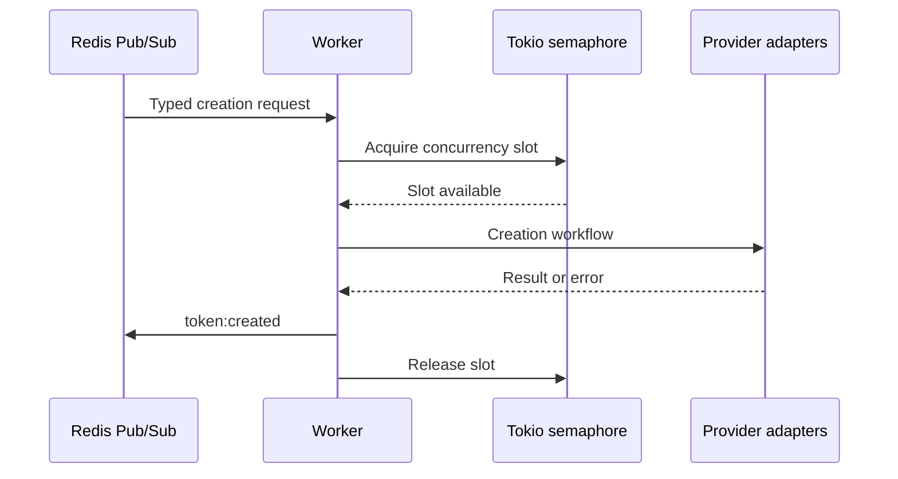

# Async Token Worker RS

   [](LICENSE)

An asynchronous Rust library and feature-gated worker for Four.Meme token-creation workflows on BSC. Typed Redis messages cross into API and blockchain adapters; Tokio tasks process requests under a semaphore limit.

**Redis Pub/Sub is the transport, not a durable job queue.** Subscribers that are offline can miss messages. This distinction matters when integrating the worker into a larger deployment pipeline.

## Compile the layers separately

```console
cargo check --lib --locked
cargo test --lib --locked
cargo check --all-features --bins --locked
```

The default Cargo feature set excludes worker and CLI binaries. See [Cargo.toml](Cargo.toml) for the opt-in features. These checks do not run a worker or submit a transaction. Windows builds require the Rust/MSVC linker prerequisites.

## Redis contract

The request parser and result types live in [redis_client.rs](src/redis_client.rs). A synthetic request has this shape:

```json
{
  "ticker": "DEMO",
  "name": "Example token",
  "description": "Synthetic documentation input",
  "source": "documentation"
}
```

Optional serialized fields include `imageBase64`, `imageUrl` and `tweetUrl`. `WORKER_TYPE` selects `deployer:en`, `deployer:zh`, `book:en` or `book:zh`; creation results are sent to `token:created`.



## Runtime configuration

| Input | Responsibility |
| --- | --- |
| `MAX_CONCURRENT` | Bounds parallel token-creation tasks. |
| `REDIS_URL` | Connects request/result transport. |
| `BSC_RPC_URL` | Selects the blockchain provider. |
| `PRIVATE_KEY` | Enables wallet authentication/signing paths. |

Provider-specific inputs are listed in [.env.example](.env.example). Unconfigured optional providers are omitted. [worker.rs](src/bin/worker.rs) implements startup and concurrency; [broadcaster.rs](src/broadcaster.rs) implements broadcast adapters.

The repository contains real signing and broadcast paths, including a binary named `test-fire-real`. Do not treat that name as an offline test. The recorded library/build checks establish compilation and covered library behavior, not latency superiority, chain success or deployment throughput.

**Technology:** Rust 2021 · Tokio · reqwest · ethers-rs · Redis · serde · tracing · Docker

Project-authored source: [MIT](LICENSE). Third-party components retain their own notices and terms.
