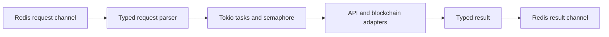

# Async Token Worker RS

**Typed Redis jobs, bounded Tokio concurrency and BSC provider adapters.**

   [](LICENSE)

[Overview](#overview) · [Quickstart](#quickstart) · [Example](#example) · [Validation](#validation) · [Documentation](#documentation)

## Overview

An asynchronous Rust worker for token-deployment workflows. Redis carries typed requests, Tokio tasks execute concurrent work under a semaphore limit, and provider adapters separate network and blockchain operations from message handling. Worker and CLI binaries are opt-in Cargo features.

**Stack:** Rust 2021 · Tokio · reqwest · ethers-rs · Redis · serde · tracing · Docker

## From message to provider action

| Component | Behavior |
| --- | --- |
| Typed requests | serde models describe token metadata and optional image/source fields. |
| Bounded concurrency | `MAX_CONCURRENT` limits parallel token-creation tasks in the worker. |
| Feature boundaries | The default feature set excludes the worker and CLI binaries. |
| Messaging semantics | Redis Pub/Sub distributes requests and results; it is not a durable replay queue. |

## Processing path



## Quickstart

```console
cargo check --lib --locked
cargo test --lib --locked
cargo check --all-features --bins --locked
```

These commands compile and test library code and compile feature-gated binaries. They do not run the worker, contact an RPC, sign transactions or broadcast. On Windows, use the Rust/MSVC toolchain and its C/C++ linker prerequisites.

## Example

**Request contract**

This synthetic message illustrates [TokenDeployRequest](src/redis_client.rs). It is documentation only; publishing it to an operational worker can trigger real execution.

```json
{
  "ticker": "DEMO",
  "name": "Example token",
  "description": "Synthetic request for contract inspection",
  "source": "documentation"
}
```

The serialized contract uses camelCase for optional fields such as `imageBase64`, `imageUrl` and `tweetUrl`. Worker modes select `deployer:en`, `deployer:zh`, `book:en` or `book:zh`; creation results are published on `token:created`.

## Configuration and storage

`WORKER_TYPE` selects a request channel; `MAX_CONCURRENT` controls parallel work. `REDIS_URL`, `BSC_RPC_URL` and `PRIVATE_KEY` configure operational dependencies. Optional provider credentials are listed in [.env.example](.env.example); providers with missing or blank values are omitted. Keep populated environment files and keys local.

## Repository guide

| Location | Responsibility |
| --- | --- |
| [Cargo.toml](Cargo.toml) | Feature flags and binary declarations |
| [src/redis_client.rs](src/redis_client.rs) | Channels and serialized request/result types |
| [src/bin/worker.rs](src/bin/worker.rs) | Worker configuration and concurrency |
| [src/broadcaster.rs](src/broadcaster.rs) | Broadcast adapter |
| [src/error.rs](src/error.rs) | Typed errors |

## Validation

Rust 1.99.1 on Windows/MSVC: library compilation, three library tests and compilation of all feature-gated binaries passed. No CLI, RPC, signing or broadcast was executed.

These are the last recorded offline checks (20 October 2026), not a new execution triggered by this documentation revision.

## Scope and operational boundaries

The repository contains real signing/broadcast paths, including a binary named test-fire-real. A test-like filename does not make a command offline. Throughput, latency and chain behavior have not been established by the recorded compilation/library checks. Rotate any credentials previously exposed in Git at their providers.

## Documentation

- [Declared features and dependencies](Cargo.toml)
- [Container build definition](Dockerfile)

## License and attribution

Project-authored source code is licensed under the [MIT License](LICENSE). Third-party components and datasets retain their respective rights and licenses.
